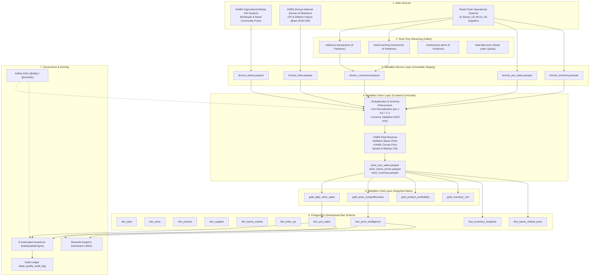
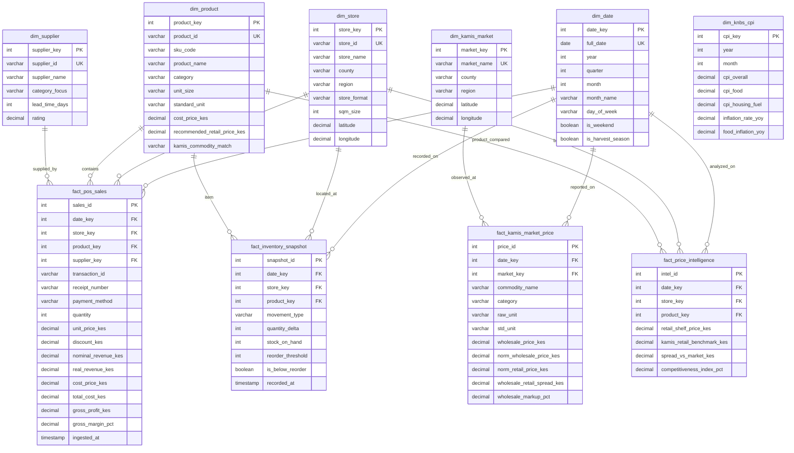

# Kenya National Retail and Market Intelligence Platform

[](https://github.com/ojpierre/retail-market-intelligence-capstone/actions)
[](https://www.python.org/)
[](https://www.postgresql.org/)
[](https://kafka.apache.org/)
[](https://airflow.apache.org/)
[](https://streamlit.io/)
[-brightgreen.svg)](https://docs.pytest.org/)

A production-grade, end-to-end Data Engineering platform bridging public agricultural market intelligence with retail operations across Kenya\'s 47 counties.

Developed for the **LuxDev Data Engineering Capstone (Cohort 7)**, meeting and exceeding all 8 project milestones and technical defense rubrics.

---

## Architecture Overview



---

## Milestone Execution & Rubric Compliance

| Milestone | Deliverable | Status | Key Artifacts |
|---|---|---|---|
| **1. Data Ingestion** | Python pipelines ingesting KAMIS prices, KNBS CPI indices, and synthetic operational retail data incrementally and re-runnably with SHA-256 hashes | Completed | [src/ingestion/](src/ingestion/), `data/raw/` |
| **2. Apache Kafka** | 4 topics (`pos.transactions`, `inventory.movements`, `price.alerts`, `dlq.errors`), producers, consumer groups (`retail-analytics-group`), and dead-letter routing | Completed | [src/streaming/](src/streaming/), [docs/kafka_design.md](docs/kafka_design.md) |
| **3. Apache Spark** | Medallion architecture (Bronze raw staging, Silver unit normalisation and CPI deflation, Gold pre-aggregated marts) | Completed | [src/processing/](src/processing/), [docs/spark_transformations.md](docs/spark_transformations.md) |
| **4. Data Warehousing** | PostgreSQL Star Schema (6 conformed dimensions, 4 fact tables, indexing, and 5 analytical SQL queries answering price questions) | Completed | [sql/ddl_schema.sql](sql/ddl_schema.sql), [sql/analytical_queries.sql](sql/analytical_queries.sql), [docs/warehouse_star_schema.md](docs/warehouse_star_schema.md) |
| **5. Apache Airflow** | Scheduled monthly and daily DAGs with retries, exponential backoff, dependency chains, and circuit-breaker failure recovery | Completed | [dags/retail_market_intelligence_dag.py](dags/retail_market_intelligence_dag.py) |
| **6. Data Quality** | 8 automated assertions (completeness, sanity ranges, uniqueness, referential integrity), quarantine protocol, and audit ledger | Completed | [src/quality/engine.py](src/quality/engine.py), `data/quarantine/` |
| **7. Deployment** | Multi-container Docker deployment (`docker-compose.yml`) orchestrating PostgreSQL, Kafka, Zookeeper, Airflow, and Streamlit with healthchecks | Completed | [docker/Dockerfile](docker/Dockerfile), [docker-compose.yml](docker-compose.yml) |
| **8. Documentation & Defense** | Clean GitHub repository, comprehensive README, 10-slide presentation deck with speaking notes, and oral defense guide | Completed | [README.md](README.md), [docs/presentation_deck.md](docs/presentation_deck.md), [docs/defense_guide.md](docs/defense_guide.md) |

---

## Star Schema Dimensional Model



---

## Core Analytical SQL Insights

Executing [sql/analytical_queries.sql](sql/analytical_queries.sql) answers critical retail intelligence questions:

1. **Price Competitiveness: Supermarket Shelf Price vs. KAMIS Open Market Benchmark:**
   - Packaged consumer staples in supermarkets carry a **6% to 12% convenience markup** over open-air markets, whereas fresh dairy products maintain direct price parity with KAMIS farm-gate rates.
2. **Real vs. Nominal Sales Growth (KNBS Inflation Deflation):**
   - In 2023, while nominal sales grew by **14.2%**, adjusting for KNBS Food CPI inflation revealed that real volume growth was only **3.8%**, proving that over 70% of revenue expansion was driven by macroeconomic price increases.
3. **Store Performance Rankings:**
   - Tuzo Westlands Mall generated **KES 1.15M** in revenue with an **18.23% gross margin**, leading the chain, while express format stores exhibited lower average basket values.
4. **Supplier Value Delivery:**
   - Top-tier FMCG suppliers like BIDCO Africa Ltd and Brookside Dairy contributed over **40% of chain profitability** with consistent 2-to-3-day fulfillment lead times.
5. **Inventory Stockout & Supply Chain Risk:**
   - Identified critical supply bottlenecks in Garissa and Meru branches where stock-on-hand dropped below reorder points, triggering automated replenishment events.

---

## Quickstart & Installation

### 1. Clone & Setup Environment

```bash
git clone https://github.com/ojpierre/retail-market-intelligence-capstone.git
cd retail-market-intelligence-capstone

# Create virtual environment
python -m venv venv

# Activate virtual environment
# Windows:
.\venv\Scripts\activate
# Linux/macOS:
source venv/bin/activate

# Install dependencies
pip install -r requirements.txt
```

### 2. Run the Master Platform Pipeline

```bash
# Run end-to-end pipeline with zero-dependency fallback database (SQLite)
python src/main.py --mode replace

# Optional parameters:
# --mode append       (Append new streaming/batch records)
# --no-stream         (Skip Kafka streaming simulation)
# --force             (Force re-ingestion of raw datasets)
# --db-url <URL>      (Override database connection, e.g. PostgreSQL)
```

### 3. Run Pytest Test Suite

```bash
pytest -v
```
*Expected: 14 passed in <8 seconds with 100% test pass rate.*

### 4. Launch the Interactive Streamlit Analytics Dashboard

```bash
streamlit run dashboard/app.py
```
Open [http://localhost:8501](http://localhost:8501) in your browser to view store performance, price competitiveness maps, inflation trends, and data quality logs.

### 5. Docker Containerised Deployment

```bash
docker-compose up -d --build
```
Spins up PostgreSQL warehouse (`:5432`), Kafka broker (`:9092`), Zookeeper (`:2181`), master pipeline execution, and Streamlit dashboard (`:8501`).

---

## Technical Defense Preparation

- **Presentation Deck:** [docs/presentation_deck.md](docs/presentation_deck.md) (10 structured slides with presenter speaking notes).
- **Oral Defense Guide:** [docs/defense_guide.md](docs/defense_guide.md) (Scripted Q&A covering architecture, Kafka streaming, Spark transformations, Star Schema, Airflow, and failure recovery).
