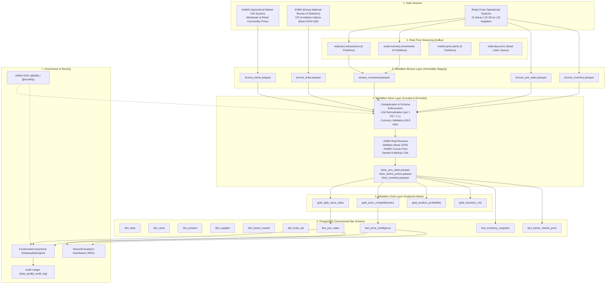

# System Architecture: Kenya National Retail and Market Intelligence Platform

## 1. High-Level Architecture Overview

The platform bridges macro-economic public market intelligence with granular micro-retail operations using an end-to-end Medallion (Bronze -> Silver -> Gold) data architecture supported by real-time Kafka streaming, Spark-compatible batch processing, PostgreSQL warehousing, and Apache Airflow orchestration.

---

## 2. Medallion Layer Responsibilities

1. **Bronze Layer (`data/bronze/`):**
   - Preserves raw source data in immutable, partitioned Parquet format.
   - Appends ingestion lineage metadata (`_bronze_ingested_at`, `_source_file`).
   - Acts as replayable storage for backfills and auditing.

2. **Silver Layer (`data/silver/`):**
   - Cleans and deduplicates records (removing redundant `transaction_id`s).
   - Standardises disparate trading units (divides wholesale 90kg/50kg bags by respective divisors into canonical base units: 1 KG / 1 L).
   - Deflates nominal sales to real 2019 constant prices using KNBS Food CPI index.
   - Enriches sales with prevailing county KAMIS market price benchmarks.

3. **Gold Layer (`data/gold/`):**
   - Pre-aggregates dimensional metrics: Daily store sales, county price competitiveness indexes, product margin rankings, and inventory stockout risk.
   - Direct feeder into the PostgreSQL Kimball dimensional model.
